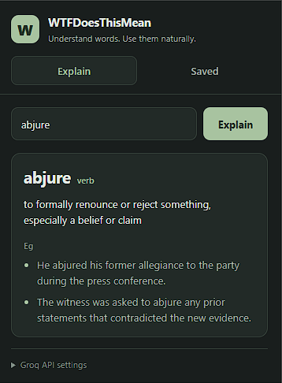
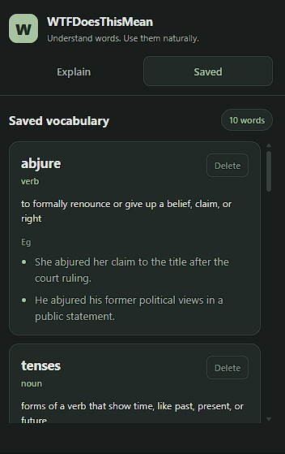
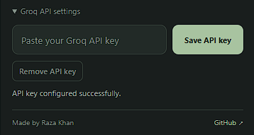

# WTFDoesThisMean

A Chrome extension that explains English words in plain language and saves them so you don't forget them.

I'm not a native English speaker, and I built this for myself first.

## Why I made it

Dictionaries tell you what a word means. They don't really tell you how people use it. I kept running into words where I understood the definition and still had no idea when I'd actually say it in a conversation.

The other problem is that I'd look a word up, think "okay, got it", and forget it a few days later. Then I'd look up the same word again.

So this does two things:

1. Explains a word in simple English and gives two everyday American English examples, so you see it used the way people actually talk.
2. Saves every word you look up, so you can go back and revise it instead of searching again.

## What it does

- Simple explanation of the word
- Part of speech (noun, verb, adjective, etc.)
- Two conversational examples
- Saves explained words automatically
- Lets you browse your saved words
- Lets you delete the ones you don't need
- Works on one word at a time (that's all it's built for)

## Screenshots

## Screenshots

<p align="center">
  
  
  
</p>

## How it works

It calls the Groq API with the `openai/gpt-oss-20b` model to generate the explanation and examples. You need your own Groq API key.

## Setup

You'll need Node.js, npm, Chrome (or any Chromium browser), and a Groq API key.

```bash
git clone https://github.com/khanrazadev/wtf-does-this-mean.git
cd wtf-does-this-mean
npm install
npm run build
```

## Load it in Chrome

After the build finishes:

- Open `chrome://extensions/` in a new tab
- Turn on **Developer mode** (top right)
- Click **Load unpacked**
- Select the `dist` folder
- Open the extension and paste your Groq API key in settings

## What I want to add next

- Right click a selected word on any webpage to explain it
- Better ways to revise saved words
- Ways to organize saved words
- A hosted backend, so people don't need their own API key
- Publish it on the Chrome Web Store

## Built with

TypeScript, Vite, Chrome Extension APIs, Groq API

## Privacy

Your saved words and your API key stay in your browser (Chrome Storage). The words you ask about get sent to Groq so it can generate the answer. No account needed.

## Contributing

Found a bug or have an idea? Open an issue or send a PR.

